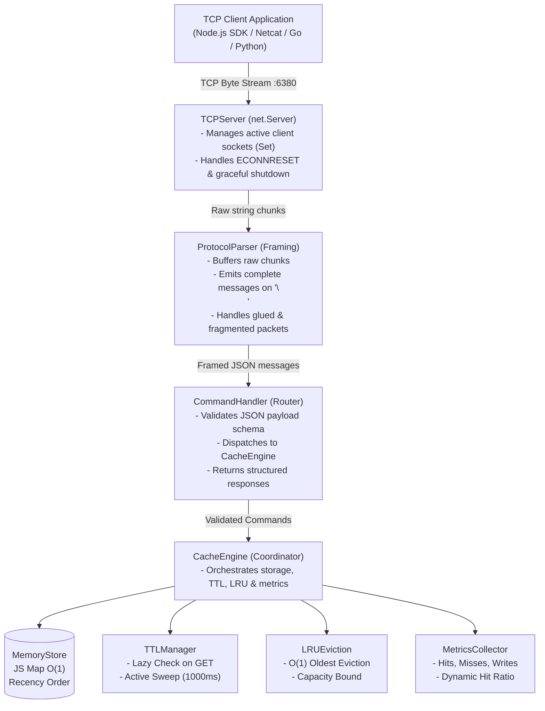

# CacheMesh ⚡

> **A lightweight, standalone, in-memory key-value caching server inspired by Redis, engineered from scratch in TypeScript and Node.js with zero runtime dependencies.**

[](https://www.typescriptlang.org/)
[](https://nodejs.org/)
[](https://vitest.dev/)
[-orange.svg?style=flat-square)](#technology-stack)
[](LICENSE)

CacheMesh implements its own core caching engine from first principles. It demonstrates fundamental systems programming concepts: **$O(1)$ LRU eviction**, **dual-strategy TTL expiration**, **TCP stream delimiter framing**, **concurrent request pipelining**, and **real-time telemetry**—operating over standard TCP sockets (Port 6380).

---

## Table of Contents
* [The Problem CacheMesh Solves](#the-problem-cachemesh-solves-a-real-world-example)
* [System Architecture](#system-architecture)
* [Key Features](#key-features)
* [Technology Stack](#technology-stack)
* [Quickstart & Installation](#quickstart--installation)
* [How to Use CacheMesh](#how-to-use-cachemesh)
  * [1. Interactive CLI Playground](#1-interactive-cli-playground-redis-cli-style)
  * [2. Node.js Client SDK](#2-nodejs-client-sdk)
  * [3. Language-Agnostic Raw TCP](#3-language-agnostic-raw-tcp-python-go-curl-netcat)
* [Wire Protocol Specification](#wire-protocol-specification)
* [Systems Engineering Deep Dive](#systems-engineering-deep-dive)
  * [O(1) LRU Eviction via Map Insertion Order](#1-o1-lru-eviction-via-ecmascript-map-insertion-order)
  * [Dual-Strategy Expiration & Zombie Keys](#2-dual-strategy-expiration-preventing-zombie-keys)
  * [TCP Stream Framing & Request Pipelining](#3-tcp-stream-framing--fifo-request-pipelining)
* [Empirical Performance Benchmarks](#empirical-performance-benchmarks)
* [Test Suite & Verification](#test-suite--verification)
* [Project Structure](#project-structure)
* [Known Limitations & Roadmap](#known-limitations--future-roadmap)

---

## The Problem CacheMesh Solves (A Real-World Example)

Imagine you run an E-Commerce API serving **10,000 requests per minute** for a viral product page (`/api/products/iphone-16`).

```
WITHOUT CACHEMESH:
[10,000 Shoppers] ──► [Node.js Server] ──► [PostgreSQL Database (Disk)]
                                           ⚠️ 10,000 disk JOIN queries/min
                                           ⚠️ CPU spikes to 100%, 8s latency, DB crashes

WITH CACHEMESH:
[10,000 Shoppers] ──► [Node.js Server] ──► [CacheMesh (In-Memory RAM)] ──► [PostgreSQL]
                                           ⚡ Served in 0.1ms directly    (Queried ONCE)
                                           ⚡ DB CPU drops to 2%
```

1. **Database Protection**: Querying relational databases or disks takes **15 to 50ms**. Hitting disk 10,000 times for identical data crashes databases. CacheMesh serves data from RAM in **0.1ms**, reducing DB load by 99%.
2. **Centralized Shared State**: A local JavaScript variable (`new Map()`) is trapped inside one Node.js process and vanishes on every server restart. CacheMesh runs as a standalone network server accessible by any number of microservices.
3. **Bounded Memory**: Unlimited in-memory stores eventually crash with Out-Of-Memory (OOM). CacheMesh enforces a strict **$O(1)$ LRU capacity limit** and purges stale entries via **TTL expiration**.

---

## System Architecture

CacheMesh separates networking, stream framing, command routing, storage, and telemetry into independent, decoupled layers:



---

## Key Features

* **$O(1)$ LRU Eviction**: Exploits ECMAScript `Map` insertion-order guarantees to prune the least recently accessed items in constant time when capacity is reached.
* **Dual-Strategy TTL Management**:
  * **Lazy Expiration**: Expired keys are caught and removed instantly on read ($O(1)$ amortized).
  * **Active Periodic Sweeping**: Background timer samples and purges inactive "zombie" keys in bounded batches every 1000ms without blocking the event loop.
  * **Leak-Free Shutdown**: Background timers use `timer.unref()` and clean lifecycle hooks.
* **TCP Stream Delimiter Framing**: Custom newline-delimited (`\n` / `\r\n`) JSON protocol. Resilient against fragmented TCP segments, glued packets, and client connection resets (`ECONNRESET`).
* **Request Pipelining**: Node.js client correlates asynchronous requests and responses over a single socket using a FIFO queue—no Request IDs needed.
* **Real-time Observability**: Built-in metrics tracking total requests, writes, hits, misses, deletes, evictions, expired keys, current entries, and live hit ratio.
* **Zero Runtime Dependencies**: Built strictly using Node.js standard built-ins (`net`, `events`, `perf_hooks`).

---

## Technology Stack

| Layer | Technology | Justification |
| :--- | :--- | :--- |
| **Language** | TypeScript (Strict Mode, ES2022) | Full static type safety, no `any`, modern async/await syntax. |
| **Runtime** | Node.js (v18+) | Native event loop (libuv reactor pattern) provides single-threaded atomic operations. |
| **Networking** | Node.js built-in `net` module | Raw TCP stream manipulation without heavy HTTP/framework overhead. |
| **Storage** | ECMAScript `Map` | Guarantees deterministic key insertion order for $O(1)$ LRU eviction. |
| **Test Runner**| Vitest | Fast in-memory unit testing and real loopback TCP integration testing. |
| **Bundler** | tsup (esbuild-powered) | Emits clean CommonJS, ESM, and `.d.ts` declaration maps. |
| **Code Quality**| ESLint + Prettier | Consistent code formatting and static analysis. |

---

## Quickstart & Installation

### Prerequisites
* Node.js $\ge$ 18.0.0
* npm $\ge$ 9.0.0

### Setup
```bash
# Clone repository
git clone https://github.com/your-username/cachemesh.git
cd cachemesh

# Install dev dependencies
npm install

# Build bundles (ESM, CJS, Types)
npm run build
```

---

## How to Use CacheMesh

### 1. Interactive CLI Playground ("redis-cli" style)

Start the server in one terminal and open the interactive playground in another:

```bash
# Terminal 1: Start Server
npm start
# Output: [CacheMesh] Server listening on 127.0.0.1:6380
```

```bash
# Terminal 2: Start CLI REPL
npm run cli
```

```text
================================================================
             CacheMesh Interactive CLI Playground ⚡            
================================================================
Connecting to CacheMesh at 127.0.0.1:6380...
Connected successfully!

cachemesh> PING
PONG -> PONG

cachemesh> SET user:1 {"name":"Alex","role":"Admin"}
OK (Stored 'user:1')

cachemesh> GET user:1
{
  "name": "Alex",
  "role": "Admin"
}

cachemesh> SET temp:token "secret123" 5
OK (Stored 'temp:token' with 5s TTL)

cachemesh> GET temp:token
secret123

# Wait 5 seconds...
cachemesh> GET temp:token
(nil / expired / not found)

cachemesh> INFO
--- Server Statistics ---
  Total Requests:  5
  Writes:          2
  Cache Hits:      2
  Cache Misses:    1
  Expired Keys:    1
  Current Entries: 1
  Hit Ratio:       66.67%
```

---

### 2. Node.js Client SDK

CacheMesh ships with a lightweight, Promise-based TypeScript/JavaScript client:

```typescript
import { CacheMeshClient } from "cachemesh/client";

async function main() {
  const client = new CacheMeshClient({ host: "127.0.0.1", port: 6380 });
  await client.connect();

  // Store key with 60-second TTL
  await client.set("session:token:101", { userId: 42, role: "editor" }, { ttl: 60 });

  // Retrieve key
  const session = await client.get("session:token:101");
  console.log(session); // { userId: 42, role: "editor" }

  // Check existence
  const exists = await client.exists("session:token:101"); // true

  // Delete key
  await client.delete("session:token:101"); // true

  // Inspect live telemetry
  const stats = await client.info();
  console.log(`Hit Ratio: ${(stats.hitRatio * 100).toFixed(1)}%`);

  await client.close();
}

main();
```

---

### 3. Language-Agnostic Raw TCP (Python, Go, Curl, Netcat)

Because CacheMesh uses newline-delimited JSON over raw TCP, any language or command-line tool can communicate with it directly:

```bash
# Connect using netcat
nc 127.0.0.1 6380
```

```json
{"command":"PING","message":"HELLO"}
{"success":true,"message":"HELLO"}

{"command":"SET","key":"inventory:item","value":{"stock":45},"ttl":120}
{"success":true,"message":"Value stored"}

{"command":"GET","key":"inventory:item"}
{"success":true,"value":{"stock":45}}

{"command":"INFO"}
{"success":true,"stats":{"totalRequests":3,"hits":1,"misses":0,"writes":1,"deletes":0,"evictions":0,"expiredKeys":0,"currentEntries":1,"hitRatio":1}}
```

#### Run Pre-Packaged Examples:
```bash
# Run Node.js Client SDK example:
npm run example:basic

# Run Raw TCP Pipelining example:
npm run example:raw
```

---

## Wire Protocol Specification

Every command sent to CacheMesh is a single JSON object terminated by a newline (`\n` or `\r\n`).

### Supported Commands

| Command | Arguments | Example Payload | Example Response |
| :--- | :--- | :--- | :--- |
| **`SET`** | `key` (string), `value` (any JSON), `ttl` (optional seconds) | `{"command":"SET","key":"k1","value":123,"ttl":60}` | `{"success":true,"message":"Value stored"}` |
| **`GET`** | `key` (string) | `{"command":"GET","key":"k1"}` | `{"success":true,"value":123}` *(or `null`)* |
| **`DEL`** | `key` (string) | `{"command":"DEL","key":"k1"}` | `{"success":true,"deleted":true,"message":"Key deleted"}` |
| **`EXISTS`** | `key` (string) | `{"command":"EXISTS","key":"k1"}` | `{"success":true,"exists":true}` |
| **`INFO`** | none | `{"command":"INFO"}` | `{"success":true,"stats":{...}}` |
| **`PING`** | `message` (optional string) | `{"command":"PING","message":"TEST"}` | `{"success":true,"message":"TEST"}` |

---

## Systems Engineering Deep Dive

### 1. $O(1)$ LRU Eviction via ECMAScript `Map` Insertion Order
In traditional systems (C++/Java), an LRU cache requires a Hash Table plus a Doubly Linked List to splice nodes.
In CacheMesh, we exploit the ECMAScript 2015+ specification guarantee:
> *"Map keys are iterated in insertion order: the first key inserted is the first key returned by `.keys()`."*

* **Access / Touch ($O(1)$)**: When a key is accessed, we delete and immediately re-insert it:
  ```typescript
  this.store.delete(key);
  this.store.set(key, entry);
  ```
  V8 moves the entry to the tail of the internal hash table in $O(1)$ time, marking it **Most Recently Used (MRU)**.
* **Eviction ($O(1)$)**: When `store.size >= maxEntries`, the oldest key is retrieved from the head of the iterator in $O(1)$ time:
  ```typescript
  const oldestKey = this.store.keys().next().value;
  this.store.delete(oldestKey);
  ```

### 2. Dual-Strategy Expiration (Preventing Zombie Keys)
* **Lazy Expiration**: On every `GET` or `EXISTS`, CacheMesh evaluates `Date.now() >= expiresAt`. If expired, it deletes the key and returns a miss. Cost: $O(1)$.
* **The "Zombie Key" Flaw**: If a client writes 500,000 keys with a 60-second TTL and never queries them again, lazy expiration never touches them. They become permanent memory leaks.
* **Active Periodic Sweep**: CacheMesh runs a background timer every 1000ms. To protect the single-threaded event loop from latency spikes, each sweep evaluates a bounded batch of keys (`maxSweepBatchSize: 100`), ensuring deterministic tail latency ($p99$).

### 3. TCP Stream Framing & FIFO Request Pipelining
TCP is a **byte stream**, not a packet protocol. Network MTU and TCP windowing cause:
* **Glued Packets**: Multiple commands arrive in a single chunk (`{"command":"PING"}\n{"command":"GET"...}\n`).
* **Fragmented Packets**: A single JSON message arrives sliced across multiple packets (`{"command":"SE` followed by `T","key":1}\n`).

`ProtocolParser` maintains a persistent buffer per socket, searching for `\n` boundaries. Complete lines are sliced and parsed; residual fragments remain in the buffer until subsequent bytes arrive.

Because TCP guarantees strictly ordered delivery, `CacheMeshClient` correlates concurrent pipelined requests using a **FIFO resolver queue** (`pendingQueue.shift()`), eliminating the need for request IDs.

---

## Empirical Performance Benchmarks

Run the benchmark suite on your machine:
```bash
npm run bench
```

Tested on Windows x64 (AMD Ryzen 5 5600H, 12 cores, Node.js v24.13.0):

| Layer | Iterations | Throughput (Ops/sec) | Avg Latency | Median ($p50$) | 95th %ile ($p95$) |
| :--- | :---: | :---: | :---: | :---: | :---: |
| **1. Direct JavaScript `Map`** | 20,000 | **6,039,000 ops/s** | 0.0002 ms (200 ns) | 0.0001 ms | 0.0003 ms |
| **2. CacheMesh Engine** | 20,000 | **1,976,000 ops/s** | 0.0005 ms (500 ns) | 0.0003 ms | 0.0007 ms |
| **3. CacheMesh TCP (Loopback)** | 2,000 | **9,500 ops/s** | 0.1052 ms (105 µs) | 0.0929 ms | 0.1795 ms |

### Why is TCP ~240x slower than Direct RAM?
* **Direct Map**: Operates purely in user-space DRAM memory (~200 nanoseconds), dereferencing heap pointers directly.
* **TCP Network**: Incurs JSON string serialization, kernel context switches (`send`/`recv` syscalls), loopback network stack traversal, stream framing, and event loop microtask scheduling (~105 microseconds).
* **Takeaway**: Despite the latency difference, standalone network caches are essential in production to provide shared state across horizontally scaled application servers and prevent process restarts from wiping cache data.

---

## Test Suite & Verification

CacheMesh maintains 100% test coverage across 10 test suites using Vitest:

```bash
# Run all 75 tests
npm test

# Run tests in watch mode
npm run test:watch

# Run linter
npm run lint

# Format codebase
npm run format
```

```text
 ✓ tests/unit/memory-store.test.ts (9 tests)
 ✓ tests/unit/lru-eviction.test.ts (6 tests)
 ✓ tests/unit/command-handler.test.ts (10 tests)
 ✓ tests/unit/metrics.test.ts (5 tests)
 ✓ tests/unit/parser.test.ts (7 tests)
 ✓ tests/unit/ttl-manager.test.ts (7 tests)
 ✓ tests/unit/cache-engine.test.ts (14 tests)
 ✓ tests/integration/tcp-server.test.ts (8 tests)
 ✓ tests/integration/client.test.ts (8 tests)
 ✓ tests/integration/endtoend.test.ts (1 test)

 Test Files  10 passed (10)
      Tests  75 passed (75)
```

---

## Project Structure

```text
cachemesh/
├── src/
│   ├── index.ts                 # CLI bootstrapper & startServer()
│   ├── server/
│   │   └── tcp-server.ts        # Node net.Server socket lifecycle manager
│   ├── protocol/
│   │   ├── types.ts             # Wire protocol command & response interfaces
│   │   ├── parser.ts            # Delimiter stream framer (\n / \r\n)
│   │   └── response.ts          # Standardized response factory
│   ├── engine/
│   │   ├── types.ts             # CacheEntry, CacheValue, IMemoryStore
│   │   ├── memory-store.ts      # O(1) Map wrapper with LRU order tracking
│   │   ├── ttl-manager.ts       # Expiration logic (lazy check + periodic sweep)
│   │   ├── lru-eviction.ts      # Capacity enforcement & recency pruning
│   │   └── cache-engine.ts      # Core caching engine coordinator
│   ├── commands/
│   │   └── command-handler.ts   # Command validation & routing
│   ├── stats/
│   │   └── metrics.ts           # Telemetry collector & hit-ratio calculations
│   └── client/
│       ├── client.ts            # Promise-based TCP client SDK with FIFO queue
│       └── index.ts             # Dedicated client module export
├── tests/
│   ├── unit/                    # Isolated tests for store, LRU, TTL, commands, parser
│   └── integration/             # Real TCP socket tests, concurrent clients, end-to-end
├── benchmarks/
│   └── benchmark.ts             # Microsecond latency and throughput benchmark runner
├── examples/
│   ├── basic-usage.ts           # Node.js SDK example
│   ├── raw-tcp-client.ts        # Raw TCP socket pipelining example
│   └── interactive-cli.ts       # Interactive redis-cli style terminal REPL
├── docs/
│   ├── architecture.md          # In-depth request lifecycle documentation
│   ├── interview-guide.md       # Senior systems engineering Q&A guide
│   └── project-overview.md      # Executive summary
├── package.json
├── tsconfig.json
├── tsup.config.ts
├── vitest.config.ts
└── README.md
```

---

## Known Limitations & Future Roadmap

### Version 1 Engineering Scope
* **Entry-Count vs. Byte Memory**: Version 1 bounds memory by entry count. In a garbage-collected runtime like V8, precise byte-level object calculation requires recursive inspection which introduces high CPU overhead on writes.
* **Single-Node In-Memory**: Designed for high-performance single-node caching. Does not implement clustering or distributed consensus (Raft).
* **Non-Persistent**: Data resides purely in RAM (no AOF or RDB disk writes).

### Roadmap
- [ ] Redis RESP protocol compatibility layer to allow standard `redis-cli` connections.
- [ ] Approximate byte-memory bounding based on serialized buffer lengths.
- [ ] Socket Connection Pooling for high-concurrency Node.js clients.
- [ ] Optional background snapshotting to disk for cold restarts.

---

## License

MIT License. Free for educational and commercial use.
